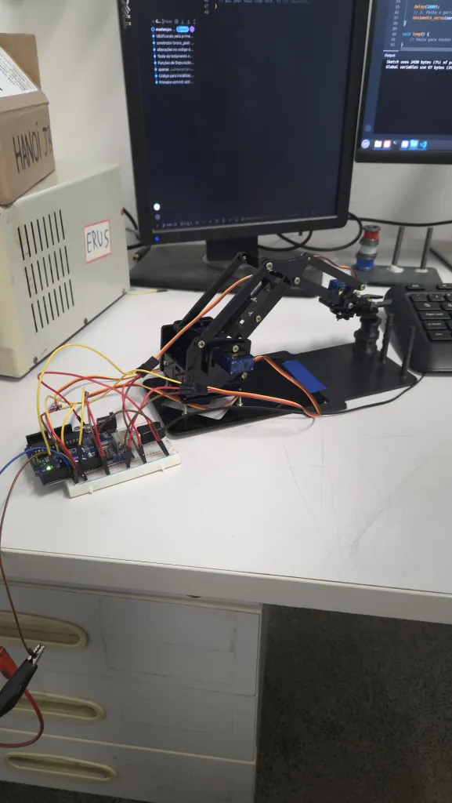
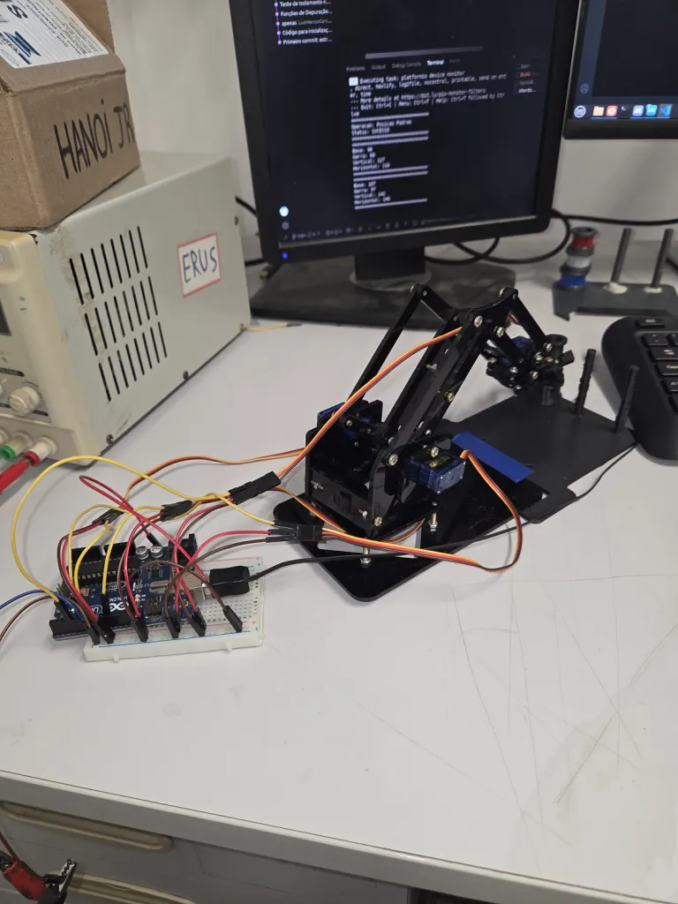
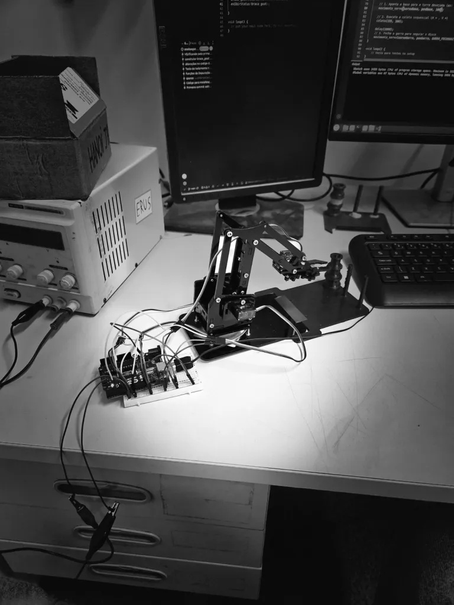

# 🤖 Braço Robótico MeArm — Resolução Autônoma da Torre de Hanói

Este repositório contém o firmware desenvolvido em **C++ (plataforma Arduino)** para controlar um manipulador robótico de 4 graus de liberdade (**MeArm**) na resolução autônoma do problema clássico da **Torre de Hanói**.

O projeto foi concebido e estruturado sob o paradigma da **Programação Orientada a Objetos (POO)**, aplicando conceitos de engenharia de software para sistemas embarcados, modularização de hardware e algoritmos recursivos.

---

## 🎯 Objetivo do Projeto

Demonstrar a aplicação prática da Programação Orientada a Objetos no controle de sistemas físicos e robótica, modelando os componentes mecânicos e a lógica matemática do desafio em entidades isoladas, seguras e reutilizáveis. 

Além do controle físico dos servomotores (com interpolação de movimento suave para evitar trancos mecânicos e picos de corrente), o sistema conta com telemetria via **Monitor Serial** para acompanhamento passo a passo da execução e simulação em circuito.

---

## 🏗️ Arquitetura e Conceitos de POO Aplicados

O software foi dividido em módulos coesos (`.h` e `.cpp`), separando as regras de negócio da camada de acionamento de hardware:

* **Abstração e Encapsulamento:** 
  * `class BracoRobotico`: Abstrai a cinemática e o estado angular das 4 juntas do robô (Base, Garra, Haste Vertical e Haste Horizontal), protegendo os atributos de posição e gerenciando o ciclo de vida dos pinos via construtor (lista de inicialização) e destrutor (`detach()`).
  * `class TorreHanoi`: Encapsula o estado atual dos discos em cada pino (`discosNoPino[3]`) e toda a sequência de coleta, recuo de segurança e soltura.
* **Composição ("Tem-um"):** 
  * O braço robótico compõe instâncias de `Servo` e classes utilitárias (`FerramentasMovimentacao` e `FerramentasExibicao`), delegando responsabilidades específicas de interpolação e depuração.
  * A torre compõe `FerramentasMedicao` para mapear logicamente pinos e níveis em ângulos calibrados.
* **Associação por Referência ("Usa-um"):** 
  * A classe `TorreHanoi` recebe e opera uma referência (`BracoRobotico &`) do manipulador instanciado na rotina principal, evitando cópias indevidas de objetos atrelados a recursos físicos do microcontrolador.
* **Recursividade:** 
  * A função `resolverHanoi()` implementa a solução clássica de divisão e conquista ($2^n - 1$ movimentos), traduzindo cada chamada recursiva em trajetórias físicas coordenadas.

---

## 📂 Estrutura de Arquivos

* `main.cpp` / `.ino`: Ponto de entrada (`setup` e `loop`), instanciação dos objetos e disparo da rotina principal.
* `braco_robotico.h` / `.cpp`: Definição e implementação do controle de juntas, posicionamento padrão e ciclo de vida dos servos.
* `hanoi.h` / `.cpp`: Lógica da Torre de Hanói, gerenciamento de níveis dos pinos, máquina de estados de movimentação e algoritmo recursivo.
* `ferramentas.h` / `.cpp`: Classes auxiliares para suavização de trajetória (`mover`), conversão de coordenadas (`FerramentasMedicao`) e logs de depuração.
* `defines.h`: Mapeamento de pinagem do microcontrolador e constantes de calibração angular de cada junta e nível.

---

## ⚙️ Hardware Utilizado

* **Manipulador:** Kit Braço Robótico MeArm em acrílico (4 DOF).
* **Atuadores:** 4x Micro Servomotores (Base, Garra, Avanço Horizontal e Elevação Vertical).
* **Controlador:** Placa compatível com Arduino (UNO / Nano).
* **Alimentação:** Fonte externa dedicada para os servomotores (recomendado para evitar quedas de tensão no microcontrolador durante movimentos simultâneos).

---

## 🖥️ Exemplo de Saída (Monitor Serial)

Durante a execução (`9600 bps`), o sistema reporta o status das operações e cada transferência realizada:

```
===============================
Operacao: Posicao Padrao
Status: SUCESSO
===============================
Discos no Pino 1: 3
Discos no Pino 2: 0
Discos no Pino 3: 0
===============================
Disco movido do pino 1 para o pino 3
...
===============================
Operacao: Resolver Hanoi
Status: SUCESSO
===============================
```

## 🚀 Próximos Passos (Roadmap)
* [ ] Desenvolvimento de PCB dedicada para distribuição de potência e estabilização elétrica dos servos.
* [ ] Implementação de novas técnicas de calibração dinâmica de distâncias e ângulos.
* [ ] Expansão para sensores de feedback na garra.


## 📸 Imagens e Vídeos





### 🎬 Vídeos

- [Assistir Vídeo 1 (Testes físicos / calibração)](https://youtu.be/dmu5MLno9_s)
- [Assistir Vídeo 2 (Execução do algoritmo / bancada)](https://youtube.com/shorts/l3MK1Re27vc?feature=share)
